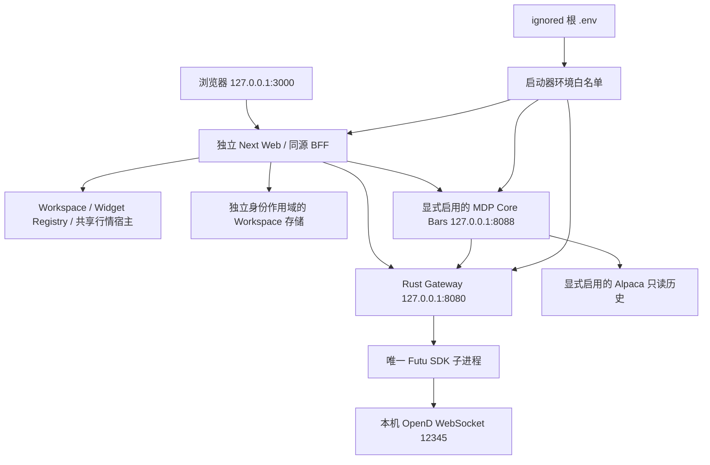

# PR64/65 审查与本机运行交付边界

日期：2026-10-16。迁移 Epic #60；完整旧功能映射见
[FEATURE_INVENTORY.md](FEATURE_INVENTORY.md)，逐项实现/验收差距见
[NATIVE_FEATURE_STATUS.md](NATIVE_FEATURE_STATUS.md)，审查修复见
[PR64_REVIEW.md](PR64_REVIEW.md)。本文不宣布完成全面迁移。

## 已合并与本次范围

PR64 已合并为 `32bfc58124809bd3e37ac0069fd917e6be576e64`；最终候选
`a86fc42` 的测试树与该合并提交树一致。精确候选 Actions 的 326 个单元/路由
测试、27 个浏览器测试及 core/OpenBB/CodeQL 检查通过；证据链接记录于
[PR64 自审](https://github.com/lqepoch/EqoBoard/pull/64#issuecomment-6206566250)
及[合并后核验](https://github.com/lqepoch/EqoBoard/pull/64#issuecomment-6206584465)。

PR65 增加 Actions Windows 运行包、受控 loopback 身份和启动/停止工具，
解决新终端无法在本机直接使用的问题。最终 head、检查、运行包 SHA-256、
实际启动与合并结果以该 PR 最终绑定 head 的 SELF_REVIEW 和核验记录为准。
早期失败的 Actions 不能作为成功证据，先前 head 的结果不能转移给后续提交。

`apps/eqoboard-web` 提供独立应用；`tools/futu-runtime` 提供固定 SDK-only
依赖，`tools/futu-stdio.mjs` 继续由 Gateway 管理。原生主运行包不依赖
OpenTerminal 应用包、旧 Node Server 或 OpenBB Lite。不同 Research 实例仍需
独立 hostname、OIDC 和 signer，本机终端不提供其权限。

## 功能与安全结论

| 项目 | 本次实际行为 | 验收限制 |
|---|---|---|
| 原生 Workspace/Widget | 独立 SDK、布局持久化和导入/导出；Windows 包执行保存/恢复验收 | 不等于所有旧功能交互及历史用户数据迁移通过 |
| 行情/期权/图表 | 共用 Gateway/BFF，保持来源、unknown/partial 与代次语义 | 合成 Runner 不验证 SIP/OPRA/Futu 权限、额度或实时性；本机期权保持不可用 |
| OpenBB 研究借鉴 | 采用自主研究界面、表格与查询机制，详见能力矩阵 | 不引入完整 Workspace/ODP 强制依赖，不使用未授权 Enterprise 功能 |
| 本机身份 | 显式启用、精确 loopback Host/Origin/端口及代理头校验，独立 issuer/subject | 不能替代生产 OIDC；独立开关仅允许 MDP terminal market:read，Engine/Quant/MDP Research signer 仍拒绝 |
| 凭据 | ignored 根 .env 私有 ACL，清除继承环境后分服务白名单注入 | Futu-only 不向 Web 或 Gateway 传入不需要的 Alpaca 凭据 |
| 交易 | effective execution 固定 disabled，保留只读与离线预览 | 配置 Paper endpoint/Key 不代表 Paper 委托、账户或对账验收通过 |
| 旧源码 | 受保护源码与原许可证/patch 保留 | 不提前归档移动，不切换默认生产部署 |

## 构建、测试与可追溯性

所有公开仓库编译、单元/契约、浏览器及容器验收在精确 PR HEAD 的 GitHub
Actions 执行。本机只运行经校验的 Actions 预编译包，执行授权的 HTTP/TCP
运行检查，不运行 build、Next dev、Docker 或浏览器自动化测试。

Windows lane 固定 Windows 2022、Node 22.23.3、Rust 1.99.0、Python 3.14.6
及校验后的 NASM；独立 runtime.json、全文件 SHA256SUMS 和 archive hash
绑定候选。真实运行包通过本机身份、Gateway 状态委托、跨源拒绝和工作区
保存/重载后才上传。Linux lane 继续执行原生构建、合成容器浏览器与 SBOM。
Core、OpenBB 和 CodeQL 门禁保留，任何失败或未知状态均阻止合并。

Research 分页传输及 OpenBB 刷新恢复曾出现 Actions 失败。Chromium
[568852319](https://issues.chromium.org/issues/568852319/dupes) 与
[8508456 修复](https://chromium-review.googlesource.com/c/chromium/src/+/8508456)
说明：完整读取 no-store 响应后，DevTools 仍可能误报取消并丢失响应体。
当前固定浏览器源码未包含该修复；这与记录中已显示数据、没有对应应用 abort
但 CDP 报 ERR_ABORTED 的现象一致。Research 测试改为旁路 clone 到 EOF 的有界
浏览器内响应证据，保持原 fetch/Response、全部来源/数据/分页及大小断言；
真实读取失败仍阻断，CDP 时间线继续留存作对照，不增加重试或忽略传输失败。
最终记录需明确验收范围，不能将单次绿灯称作长期可靠性证明。

源码来源记录在 `NATIVE_SOURCE_PROVENANCE.json`、`native06-provenance.json`、
`native07-provenance.json`；许可证审计见 `DEPENDENCY_AND_LICENSE_AUDIT.md`。
SBOM 与文件哈希证明库存和字节身份，不证明全部静态组件 notices 或数据授权。
运行包 `LOCAL_EVALUATION_ONLY`、`licenseClosure=NOT_CLAIMED` 保留。

## 尚未满足的生产切换门槛

后续 Core Bars 本机接线以固定 MDP 源码 pin 和三服务 Windows 包交付，源码/运行检查需
绑定该 PR 最终 head。MDP 独立 [PR24](https://github.com/lqepoch/market-data-platform/pull/24)
已合并，测试与主分支树一致；不把它的 CI 当作 EqoBoard 新 head 或真实历史数据验收。
当前图表是否成功还需验证日历、委托和实际 Provider 响应，Quote 成功不替代历史链路证据。

- 完整旧/新功能对照、非空真实 Provider 数据与故障恢复验收。
- Futu HTTP ACK 与 SDK 实际订阅完成的精确 ready/error 契约。
- 完整运行时许可证/notices、数据及媒体使用权证据。
- 同环境成对性能与实测预算、真实用户数据身份迁移及生产回滚演练。
- 所有选定 OpenBB 高价值研究能力的真实来源与稳定性验收。

没有修改其它仓库的源码或合并无关 Draft；锁定的 Core/connector 提交已在各自
main 历史中。九仓 Draft 治理方案仍不取代当前契约。

## 单项旧测试授权与原件保护

用户于 2026-10-16 独立授权“授权，仅修复这项旧测试并记录审计”。只将
`apps/openterminal/web/e2e/openbb-lite.spec.ts` 中刷新恢复 QQQ 的 CSS selector
改为限定该 Widget 的精确 `gridcell/QQQ` 可见断言；保留全部 API、数据、权限、
来源和其它断言，不修改旧运行时代码。原件逐字节复制到
`references/legacy/authorized-originals/pr65/openbb-lite.spec.ts`，SHA-256 为
`593edeb81e7c8b3fce43d5d211595c982e84d47f7bc681254400a87eeef4220b`。

授权记录在 `docs/evidence/legacy-integrity-authorizations/pr65-openbb-qqq-cell.json`。
冻结 Tag/233 文件 manifest/原 Git blob 保持不变，完整性工具另核对固定摘要
授权记录、原件以及这一修订的精确 index/worktree 身份；不接受其它旧文件改动。
此项是已记录的当前测试修订，不能继续宣称当前所有旧路径均与基线字节相同。

## 运维与回滚

配置、下载、ACL、启动/停止命令见 [NATIVE_LOCAL_START.md](../NATIVE_LOCAL_START.md)。
状态和日志保留在 ignored `data/native-local`，不把行情或凭据上传公开产物。
停止仅针对状态记录中 PID、创建时间与路径一致的本任务进程，不处理 OpenD。
回滚保留 .env/数据库/日志，选择上一已验证候选运行包或仍保留的旧默认部署；
不兼容数据使用独立目录，禁止覆盖、自动归属旧 SQLite。
